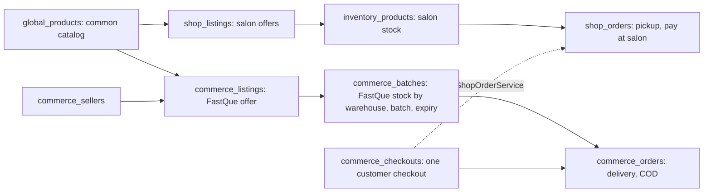
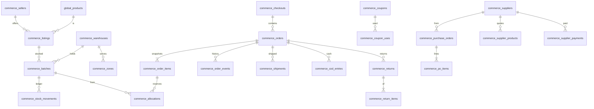

# FastQue Direct Commerce

Products FastQue sells itself, delivered with Cash on Delivery, beside the existing salon marketplace
(`docs/shop/MARKETPLACE.md`), which is unchanged. No online payment exists anywhere in this feature.

## Protection: what existing code changed

Recovery checkpoint: `8965d964` (tag `checkpoint/direct-commerce-base`).

| Existing file | Change | With flags off |
| --- | --- | --- |
| `backend/src/app.module.ts` | imports `CommerceModule` | routes answer 404 (except `commerce/config`) |
| `backend/src/shop/shop.module.ts` | exports `ShopOrderService` | no change |
| `backend/src/notifications/notifications.service.ts`, shared `types`, `i18n`, web `NotificationBell` | three notification types | never sent |
| `prisma/schema.prisma` | `GlobalProduct.commerceListings` back-relation, 25 new models | no change |
| web `ShopParts`, `ShopHome`, `ShopBrowse`, `ShopProduct`, `ShopCheckout`, `CustomerShop`, `shop/bag` | insert components that render nothing while off | one extra request to `commerce/config` |
| web `lib/shop/store.ts` | adds `bag.addAny` | not called |
| web `admin-nav`, `admin-route-access`, `dashboard-flags` | admin section | hidden |

No existing table, column, endpoint, response or shared style was changed. Salon prices, stock,
reservations, the 24-hour window, cancellation and expiry still run in `ShopOrderService` / `shop-stock`.

## Flags

All off unless exactly `true`. The first backend flag gates the rest.

| Flag | Turns on |
| --- | --- |
| `FASTQUE_DIRECT_COMMERCE_ENABLED` | the API, storefront and order pages |
| `MULTI_SELLER_CART_ENABLED` | one checkout for FastQue plus several salons |
| `FASTQUE_COD_ENABLED` | ordering (COD is the only payment method) |
| `FASTQUE_DELIVERY_ENABLED` | delivery zones; off = nowhere is serviceable |
| `FASTQUE_RETURNS_ENABLED` | customer return requests |
| `FASTQUE_COMMERCE_AI_ENABLED` | rule-based insights |
| `NEXT_PUBLIC_FASTQUE_DIRECT_COMMERCE_ENABLED` (web, build time) | admin sidebar section |

Guest order links use `SHOP_ORDER_TOKEN_SECRET`, falling back to `JWT_ACCESS_SECRET`, as salon orders do.

## Architecture

`commerce_sellers` holds FastQue as its own seller (`type = FASTQUE`, never a salon). The types
DISTRIBUTOR, MANUFACTURER, BRAND and WHOLESALER exist for later. Salon sellers are not copied: a row with
`salonId` can link one when needed, and a database CHECK keeps `SALON` and `salonId` together.

## Workflows

**Order.** PLACED → CONFIRMED → (PROCESSING) → PACKED → SHIPPED → OUT_FOR_DELIVERY → DELIVERED. Customers may
cancel before PACKED. DELIVERY_FAILED can be retried or become RETURN_TO_ORIGIN → RETURNED. The server refuses
every other change (`COMMERCE_TRANSITIONS`).

**Stock.** RESERVE at placement (first expiry first, row-locked) → DISPATCH at SHIPPED, or RELEASE on cancel.
Returned units enter quarantine and are inspected before RESTOCK or write-off; damaged, expired or defective
returns can never be restocked. CHECK constraints forbid negative stock and reserved > on hand. The stock,
order-history and cash ledgers reject UPDATE and DELETE. Available = on hand − reserved, unexpired only.

**Checkout.** Everything is validated first; FastQue is placed in one transaction, then each salon through
`ShopOrderService`. If a later seller fails, what was placed is cancelled and the customer is told. One
`Idempotency-Key` gives one result. If a compensation itself fails, the customer is told part of the order may be
open and the server logs an error. Limits: 5 open COD orders per phone.

**COD.** Delivery never means paid. Finance records COLLECTED → SETTLED (with courier deductions) → optional
ADJUSTMENT (reason required) → sign-off. Sign-off needs settled + adjustments = order total, and by a different
person if an adjustment was recorded.

**Procurement.** DRAFT → APPROVED (finance) → ORDERED → goods receipt with accepted/rejected quantities →
RECEIVED. Only accepted units become stock. Supplier balance = accepted value − payments. Purchases are not
copied into Finance expenses, so they are not counted twice; book them there by your accounting policy.

**Serviceability.** Zones match full PINs or PIN prefixes; blocked PINs win. No zone = no delivery.

## API

Public `commerce/`: `config`, `home`, `products`, `products/:id`, `products/:id/offer`, `sitemap-products`,
`serviceability?pin=`, `POST quote`, `POST checkout` (Idempotency-Key), `orders/:number?token=`, `…/cancel`,
`…/returns`. Customer `customer/commerce/`: `checkout`, `orders`, `orders/:number` (+`cancel`, `returns`),
`addresses`. Admin `admin/commerce/`: `me`, `overview`, `insights`, `data-quality`, `seller`, `grants`,
`catalog`, `listings`, `warehouses`, `stock`, `batches` (+`adjust`, `transfer`, `movements`), `zones`,
`coupons`, `orders` (+`transition`, `invoice`, `cod`, `reconcile`), `cod`, `returns`, `suppliers`,
`purchase-orders`, `export/orders`. Schemas: `packages/shared/src/commerce.ts`.

## Permissions

PLATFORM_ADMIN has all. Other internal admins need a grant per permission (Settings); `settings` cannot be granted.

| Role in the brief | Grants |
| --- | --- |
| Commerce admin | view, catalog, orders, delivery, support |
| Warehouse manager / staff | view, warehouse |
| Procurement manager | view, procurement |
| Finance manager | view, finance (refunds, COD, PO approval, profit and cost) |
| Customer support | view, orders, support |
| Delivery operations | view, orders, delivery |
| Salon owner, customer | none: 403 on every admin route |

Costs, suppliers and profit are only sent to `finance` / `procurement`. Warehouse permissions are not per warehouse.

## Deploy and roll back

1. Merge with all flags off; the pre-deploy `prisma migrate deploy` adds tables only.
2. Set the seller details, warehouse, zone, products and stock (backend flag on, COD and delivery off).
3. Review **Product data quality** and mark sample products as test data (reversible; nothing is deleted).
4. Turn on delivery, COD, then multi-seller.

Roll back by turning flags off. Keep the tables: dropping them would lose orders, stock and cash records.

## Test evidence

See `docs/commerce/TEST_RESULTS.md`. Tests: `packages/shared/src/__tests__/commerce.test.ts`,
`apps/backend/test/commerce.e2e-spec.ts` (disposable database `owner_ops_chain` or `commerce_ci`).

## Completion matrix

V = implemented and verified (e2e and/or browser) · N = implemented, not verified in the browser or by a dedicated test ·
X = needs external configuration · — = not implemented.

| Area | V | N | X | Not implemented (—) |
| --- | --- | --- | --- | --- |
| Flags, legacy unchanged | all six flags | | | |
| Sellers | FastQue seller, isolation | future seller types | | unified salon seller rows, distributor portal |
| Catalog | shared master product, test data excluded | | | variants model, ingredients, usage, benefits, country of origin |
| Storefront | tabs, storefront, cards, offer comparison, PIN check | filters, best sellers, bought together, recently viewed rails | | reviews and ratings, image zoom, personalised rails, banners CMS, bundles |
| Bag and checkout | mixed bag, guest COD, address snapshot, idempotency, compensation | save for later, saved addresses UI, billing address UI (API only) | | account-synced bag |
| Orders | state machine, snapshots, guest links, FEFO, cancel | packing slip print, CSV export UI | | bulk processing, courier labels, Excel export, abandoned carts |
| Inventory | batches, ledger, reserve, expire, quarantine, transfer, adjust | history UI | | barcode camera scan and CSV upload for FastQue stock, audits, per-warehouse permissions |
| Procurement | PO, approval, partial receipt, rejects, balances, payments | supplier prices UI | | purchase requests, quotations, supplier returns, PO document |
| Shipping | manual shipments, attempts, RTO | proof note | courier APIs | pickup scheduling, photo proof |
| COD | collect, settle, adjust, second-person sign-off | | | settlement file upload and matching |
| Returns | window, quarantine, inspection, refund record, replacement | admin returns UI | | photo upload, per-category policies |
| Notifications | in-app outbox with retries and dedupe, salon order alerts | | email, SMS, WhatsApp | admin low-stock / near-expiry pushes |
| Pricing, promotions | coupons, below-cost guard, MRP guard | promo window (API only), brand/category coupons | | BOGO, bundles, city offers |
| Support | | | | commerce ticket categories and order links |
| Reports | direct vs salon kept apart, cost protected | charts, date ranges | | retention, conversion, CLV, warehouse reports |
| Insights | rules with stated basis | | | demand forecasting, pricing and support agents |
| Data quality | audit, reversible marking | | | bulk cleanup run on production (needs approval) |
| Invoices | | invoice data API | GSTIN, legal name, address | PDF invoice |
