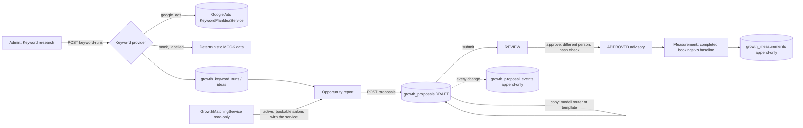

# FastQue Growth AI — Customer Acquisition (Phase 0 audit + first slice)

Demand-side growth agent from the 27-section specification. This branch covers **Phase 0 (audit and
API verification)** and the **first vertical slice in advisory mode**:

keyword intelligence → active salon matching → campaign proposal → admin approval → measurement of completed bookings

Admin section: **Growth AI → Customer Acquisition** (`/dashboard/admin/growth`). Everything is behind flags
that are off by default; with them off, every route answers 404 and the sidebar is unchanged.

Nothing in this branch spends money, publishes an ad, installs a pixel or tag, or sends a message.

## 1. Phase 0 — repository audit

Baseline: upstream `master` at `76613f8e` (2026-11-25).

| Area | What exists | Decision for Growth AI |
| --- | --- | --- |
| Admin shell | `admin-nav.ts` single nav definition, flag-gated groups (`NEXT_PUBLIC_FASTQUE_*`), `admin-route-access.ts` | New `GROWTH_AI` group behind `NEXT_PUBLIC_GROWTH_AI_ENABLED`; one `startsWith` rule |
| Flag / guard pattern | Commerce: `flag()` reads exactly `"true"` gated by a master flag; guard answers 404 while off | Same pattern: `growthFlag()`, `GrowthEnabledGuard`, per-route `@GrowthFeature` 404s |
| Staff permissions | `commerce_staff_grants` per permission on top of internal admin roles; `settings` never delegated | `growth_staff_roles` (one role per person) on top of internal admin roles; `PLATFORM_ADMIN` is always Admin |
| Booking attribution | `booking_attribution_campaigns` + `bookings.attributionCampaignId`: per-salon tokenised links (FACEBOOK / INSTAGRAM / CHATGPT / OTHER) created by owners | **Reused later** for first-party attribution of Growth campaigns. Not written to in this slice (creating rows would appear in owners' Booking Sources) |
| Completed bookings | `bookings.status = COMPLETED`, `booking_services` price snapshot | Measurement source of truth (first-party, read-only) |
| Offers | `offers`, booking rules, redemptions (PR #469) | Not used: no offer is "verified for ads" yet. Ad copy rejects offer/price claims |
| Pixels / analytics | **None on master** (no `gtag`, `fbq`, GTM). A Meta Pixel branch exists (`codex/meta-pixel`, unmerged) and the Visitor Intelligence branch (unmerged) adds a consent banner and tracker | Growth AI installs nothing. Section 7 must build on whichever consent banner lands, to avoid duplicate pixels |
| AI providers | Gemini via `@google/genai` (`GEMINI_API_KEY`) for menu OCR, catalog import, CRM sales coach (provider `none` by default, "AI Analysis Not Configured") | New provider-independent router; Anthropic adapter via the official SDK; `none` by default |
| `AGENT_LLM_PROVIDER` | Not on master (searched `apps/`, `packages/`) | Not reused; Growth uses its own `GROWTH_AI_LLM_PROVIDER` |
| `commerce_daily_stats` | Anonymous daily counters (`day`, `metric`, `count`) | Pattern noted for Phase 4 funnel counters; not used here |
| Outbox | `CommerceOutboxService`, `NotificationDeliveryService` | Not used: the slice sends nothing |
| Migrations | `scripts/verify-migration-chain.sh`, flat CHECKs, append-only triggers | Followed; chain verified on `growth_ci` and `growth_qa` |
| Test salons | No `isTest` flag on salons | `growth_salon_exclusions` table (admin managed) keeps test shops out of matching |
| Branding | Owner/admin design system (`owner.module.css`, admin commerce/inventory modules) | Reused; only a small `admin-growth.module.css` for source labels and the lifecycle strip |

Other in-flight branches touching the same files (merge notes): Visitor Intelligence adds a `VISITOR_INTEL` nav
group and a route rule in the same two files; both are one-line, independent additions.

## 2. Third-party APIs (verified 2026-11-25 against official documentation)

| API | Verified facts | Used in this slice |
| --- | --- | --- |
| Google Ads API — `KeywordPlanIdeaService.GenerateKeywordIdeas` | REST `POST https://googleads.googleapis.com/v26/customers/{id}:generateKeywordIdeas`; latest release v26.2 (2026-11-11). Request: `keywordSeed` / `urlSeed`, `language` (`languageConstants/…`), up to 10 `geoTargetConstants`, `keywordPlanNetwork` (`GOOGLE_SEARCH`), `includeAdultKeywords`, `historicalMetricsOptions`. Metrics: `avgMonthlySearches`, `monthlySearchVolumes[]`, `competition` (LOW/MEDIUM/HIGH), `competitionIndex` (0–100), `lowTopOfPageBidMicros` (20th pct), `highTopOfPageBidMicros` (80th pct). Historical metrics refresh monthly. | Yes: `GoogleAdsKeywordProvider` (unit-tested with a fake transport; **not run against a live account**) |
| Google Ads access levels | Access is now per Google Cloud project: Test (test accounts only), Explorer (**cannot use planning services**), Basic (brand verification), Standard (audit, ~10 business days). | Documented requirement: Basic or Standard |
| Google Ads auth | OAuth refresh at `https://www.googleapis.com/oauth2/v3/token`, scope `https://www.googleapis.com/auth/adwords`; `login-customer-id` header for manager accounts. The REST auth page no longer mentions the `developer-token` header after the access-level change, so it is sent **only if configured**. Re-check before go-live. | Yes |
| Claude API (Anthropic) | Models: `claude-haiku-5-5` ($0.10 / $0.50 per MTok, prompts ≤100K), `claude-sonnet-5-5` ($2 / $10). Messages API; structured output via `output_config.format` (`json_schema`); `output_config.effort`; `usage.input_tokens` / `output_tokens`; `stop_reason: "refusal"`. SDK `@anthropic-ai/sdk` pinned to **1.8.0** (released 2026-11-10; newer releases were days old). | Yes, ad-copy drafting only, off by default |
| Meta Graph / Marketing API | Latest v27.0 (2026-11-04); v26.0 (2026-07-29). | No (Phase 3) |
| GA4 Measurement Protocol | `POST https://www.google-analytics.com/mp/collect` (EU: `region1.`), `api_secret`; `consent.ad_user_data` / `ad_personalization`; ≤25 events/request, ≤25 params/event, names ≤40 chars; 2xx even on bad payloads. | No (Phase 4) |

Model IDs and prices are **configuration**, not code (`GROWTH_AI_FAST_MODEL`, `GROWTH_AI_FAST_INPUT_USD_PER_MTOK`, …).
The user's spec named Claude Haiku 4.5 / Sonnet 4.6; the current models are Haiku 5.5 / Sonnet 5.5.

## 3. Architecture of the slice

Backend: `apps/backend/src/growth/` — `growth-support.ts` (flags, guards, roles, pause), `keyword-providers.ts`,
`model-router.ts`, `growth-matching.service.ts` (read-only), `growth.service.ts`, `growth.controller.ts`.
Shared contracts and all deterministic maths: `packages/shared/src/growth-ai.ts`.
Web: `apps/web/components/admin/growth/AdminGrowth.tsx`, page `app/(dashboard)/dashboard/admin/growth`.

### Deterministic money
Integer paise everywhere; Google bids are micros (`micros / 10 000 = paise`). The preview shows budget × days,
clicks/day = budget ÷ top-of-page bid range, the average completed service value at the matched salons (FastQue
data, ≥5 samples) and, only if `GROWTH_AI_CONTRIBUTION_PER_BOOKING_INR` is set, break-even bookings/day (labelled
*assumption*). **Expected bookings are never estimated** (no measured click-to-booking rate). Real spend is always ₹0.

### Opportunity report
Columns exactly as specified: Keyword | Location | Search Demand | Competition | Recommended Channel | Matching Salons | Priority.
Priority and channel are pure functions (`opportunityPriority`, `recommendedChannel`): no supply → `NO_SUPPLY` / "None —
add salons first"; no demand data → `INSUFFICIENT_DATA` / Local SEO; <30 searches → Offline/QR; a crowded auction where
the budget buys <10 top-of-page clicks → Local SEO; otherwise Google Search. Locations are city level only.

### Lifecycle (section 5)
RESEARCH (keyword run) → DRAFT → REVIEW → APPROVE → ~~PUBLISH~~ → MONITOR. Server-enforced transitions
(`PROPOSAL_TRANSITIONS`); ad text is frozen outside DRAFT; approval needs the `approve` permission, a **different person
from the drafter** (`GROWTH_AI_REQUIRE_SECOND_APPROVER`, default on), an explicit **MOCK acknowledgement** when the proposal
uses mock data, and an unchanged preview hash. The approver, time, note and hash are stored on the proposal and in the
append-only event log. There is no publish route.

### Measurement (section 1 metric)
For an approved proposal: completed bookings with a matching service at the proposal's salons, their recorded service value,
and new customers (first completed booking ever), for the campaign window so far vs. the same number of days just before.
Shown as *observed change, not proven incremental* (no control group). First-party link attribution and platform-attributed
conversions are separate fields, both **Unavailable** in this slice. Snapshots are stored append-only.

### Model router (section 3)
Code asks for a tier (`FAST`, `QUALITY`), never a model. Provider `none` by default. Each call is logged in `growth_ai_usage`
with tokens and exact cost (micro-USD = tokens × USD/MTok); daily budget cap (`GROWTH_AI_LLM_DAILY_BUDGET_USD`, default 1);
circuit breaker (3 failures → 10 minutes off); refusals and invalid JSON are failures. Model output is only ad text for a
person to review; lines that break the rules (length, prices, offers, rankings, links, phone numbers) are dropped, and
template text is used if too few remain. Untrusted data goes in the user message as JSON, never in the system prompt; salon
names are not sent.

## 4. Flags and configuration

All off unless exactly `true`; `GROWTH_AI_ENABLED` gates the rest.

| Variable | Default | Effect |
| --- | --- | --- |
| `GROWTH_AI_ENABLED` | off | Master switch; every `admin/growth/*` route 404s while off |
| `GROWTH_AI_KEYWORDS_ENABLED` | off | Keyword research runs |
| `GROWTH_AI_CAMPAIGNS_ENABLED` | off | Proposals, ad text, transitions |
| `GROWTH_AI_MEASUREMENT_ENABLED` | off | Measurement and snapshots |
| `GROWTH_AI_LLM_ENABLED` | off | Any model call (else template ad text) |
| `GROWTH_AI_KEYWORD_PROVIDER` | `none` | `mock` (labelled) or `google_ads` |
| `GOOGLE_ADS_CUSTOMER_ID`, `GOOGLE_ADS_LOGIN_CUSTOMER_ID`, `GOOGLE_ADS_CLIENT_ID`, `GOOGLE_ADS_CLIENT_SECRET`, `GOOGLE_ADS_REFRESH_TOKEN`, `GOOGLE_ADS_DEVELOPER_TOKEN` (optional), `GOOGLE_ADS_API_VERSION` (`v26`) | empty | Real keyword data (server-side only) |
| `GROWTH_AI_LLM_PROVIDER` | `none` | `anthropic` (needs `ANTHROPIC_API_KEY`) |
| `GROWTH_AI_FAST_MODEL`, `GROWTH_AI_FAST_INPUT_USD_PER_MTOK`, `GROWTH_AI_FAST_OUTPUT_USD_PER_MTOK` (and `QUALITY_*`) | empty | No model or price → no call |
| `GROWTH_AI_LLM_DAILY_BUDGET_USD` | 1 | Hard daily cap |
| `GROWTH_AI_MAX_DAILY_BUDGET_INR` | 2000 | Largest daily budget a proposal may carry |
| `GROWTH_AI_CONTRIBUTION_PER_BOOKING_INR` | unset | Enables break-even (labelled assumption) |
| `GROWTH_AI_REQUIRE_SECOND_APPROVER` | on | `false` allows self-approval |
| `GROWTH_AI_EMERGENCY_PAUSE` | off | Server-level pause (in addition to the admin's switch) |
| `NEXT_PUBLIC_GROWTH_AI_ENABLED` (web, build time) | off | Sidebar section |

## 5. RBAC (section 19)

Only internal admin roles (PLATFORM_ADMIN, CO_FOUNDER, PLATFORM_VIEWER, HR_ADMIN, SALES_ADMIN) can hold a Growth role.

| Growth role | view | research (runs, measurement snapshots) | draft (proposals, ad text, submit, archive) | approve (approve, send back, reject) | settings (roles, pause, exclusions) |
| --- | --- | --- | --- | --- | --- |
| Admin (every PLATFORM_ADMIN) | ✓ | ✓ | ✓ | ✓ | ✓ |
| Marketing Manager | ✓ | ✓ | ✓ | ✓ | |
| Analyst | ✓ | ✓ | | | |
| Read-Only | ✓ | | | | |
| Salon owner, customer, staff without a Growth role | 403 | | | | |

## 6. Safety properties

- No publish, spend or send route exists (tested: 404). No worker, scheduler or outbox is registered.
- The AI has no database access: it receives JSON and returns ad text, which is validated and stored only as a draft. All reads
  are fixed Prisma queries in `GrowthMatchingService`; nothing writes prices, availability, bookings or spend.
- SSRF: outbound hosts are constants (Google OAuth, Google Ads, Anthropic via its SDK); no request field is a URL; geo targets
  and language constants are validated by regex; seed keywords allow letters, digits, spaces, `'&-` only.
- Mock data is stored with `isMock = true` (DB CHECK ties it to the provider) and labelled on every number in the UI.
- Emergency pause (`PUT admin/growth/pause` or env) returns 423 on every write; reads continue.
- Secrets are server-side env only; nothing about Growth AI is in `NEXT_PUBLIC_*` except the sidebar flag.
- Privacy (DPDP Act 2023): the slice processes no customer personal data beyond counting customers' first completed booking;
  measurement output is aggregate counts and sums only. No tracking is added, so no consent change is needed yet.

## 7. Data model (migration `20261128090000_growth_ai_acquisition`, additive)

New tables only: `growth_staff_roles`, `growth_controls` (single row), `growth_salon_exclusions`, `growth_keyword_runs`,
`growth_keyword_ideas`, `growth_proposals`, `growth_proposal_events` (append-only), `growth_measurements` (append-only),
`growth_ai_usage` (append-only). Flat CHECK constraints on statuses, roles, budgets, mock/provider consistency and approval
completeness. No relation fields on existing models; no existing table changes.

Roll back by turning the flags off. Keep the tables (they hold the approval record).

## 8. Test evidence (this branch)

- Shared unit: `packages/shared/src/__tests__/growth-ai.test.ts` — 13 tests (scoring, channel, money, ₹500/day preview, ad-copy
  rules, lifecycle has no PUBLISHED, roles, input validation incl. SSRF/injection-shaped input).
- Backend unit: `apps/backend/src/growth/growth-providers.spec.ts` — 11 tests (no provider by default, deterministic mock, Google
  Ads mapping, only Google hosts and correct headers, city-level location required, model config/prices, exact cost, flags,
  usage logging, refusal and bad JSON, daily budget, circuit breaker, SDK request shape).
- Backend e2e (real `AppModule`, disposable `growth_ci`): `apps/backend/test/growth-ai.e2e-spec.ts` — 13 tests (404 while off,
  403 for non-staff/no role, role grants, mock research and supply matching incl. exclusions and pending salons, NO_SUPPLY,
  proposal preview and caps, full lifecycle with second approver and MOCK acknowledgement, no publish route, append-only
  history in the database, first-party measurement, emergency pause, Unavailable dashboard, sub-flags).
  Runs only when `DATABASE_URL` names a local database called `growth_ci`.
- Web: `apps/web/components/admin/__tests__/growth-ai-nav.test.jsx` — 4 tests (flag strictness, sidebar unchanged while off).
- Regression against the baseline: see `TEST_RESULTS.md`.
- Browser walk-through of the section 26 demonstration on `growth_qa` (20 demo salons in Greater Noida, ₹500/day): screenshots
  in `screenshots/`.

Local demo data: `apps/backend/prisma/seed-growth-demo.ts` (refuses anything but a local database named `growth_qa`).

## 9. Completion matrix and later phases

V = built and verified here · N = built, not verified live · — = not built.

| Spec section | Status | Notes |
| --- | --- | --- |
| 1 Objective / metric | V (observed) | Completed bookings vs. baseline; incrementality needs a control group or holdout (later) |
| 2 Audit, branding | V | Section 1 of this document |
| 3 Model router, cost | V (unit) / N (live) | Anthropic adapter not called live (no key used) |
| 4 Keyword planning | V (mock) / N (Google Ads) | Needs a Google Ads account with Basic/Standard access; weekly report scheduling not built |
| 5 Campaign assistant | V up to APPROVE | PUBLISH/MONITOR via the Google Ads API: Phase 2 |
| 6 Meta / Instagram | — | Phase 3 (verified offers, EN/HI/Hinglish drafts) |
| 7 Tracking (GA4, GSC, Ads conversions, Pixel/CAPI, consent, dedup, canonical events) | — | Phase 4; must reuse the consent banner from Visitor Intelligence / Meta Pixel branch, one pixel only |
| 8 SEO engine | — | Phase 5 |
| 9 Supply-aware matching | V | Read-only service; capacity/availability windows later |
| 10 Hyperlocal / QR | — | Can reuse `booking_attribution_campaigns` tokens |
| 11 Offers with financial preview | — | Needs "verified for ads" offers |
| 12 Retargeting | — | Needs consent and frequency caps |
| 13 Referrals | — | Rewards only after verified completed booking |
| 14 Creator discovery | — | Optional |
| 15 CRO experiments | — | Behind flags; AI cannot change them |
| 16 Competitor intelligence | — | Evidence-linked |
| 17 Dashboard (18 sections) | V | 6 live, 12 "Unavailable" with reasons |
| 18 Admin assistant | Partial | Every proposal shows data sources, assumptions, cost, risk, approval and measurement; no chat assistant |
| 19 RBAC, injection, SSRF, secrets, privacy | V | See sections 5–6 |
| 20 Isolation, workers, circuit breakers, rollback | V (flags, breaker) | No workers needed yet |
| 21 Cost controls, emergency pause | V | LLM daily cap, proposal budget cap, pause |
| 22 Memory from real data | Partial | Measurement snapshots only |
| 23 Daily/weekly/monthly workflows | — | No scheduler in advisory slice |
| 24 Tests | V | Section 8 |
| 25 Phases | This is Phase 0 + slice of Phase 1 |
| 26 First demonstration | V (mock keyword data) | Screenshots |
| 27 Deliverables | Advisory only | |
