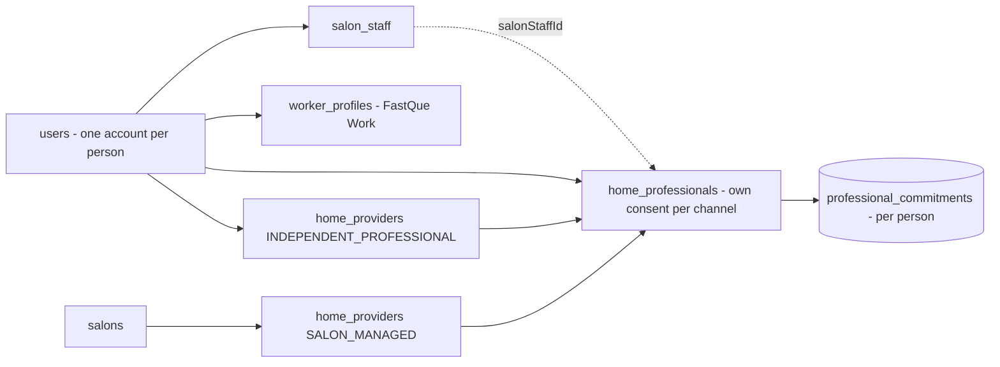
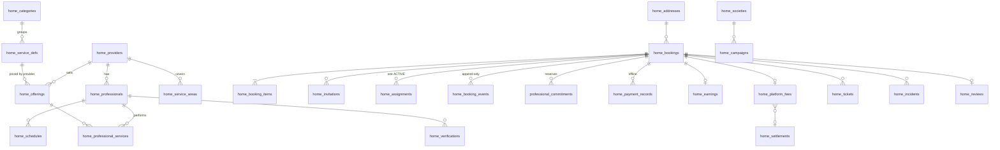

# FastQue Home

Home beauty services inside FastQue. Requirement: [FASTQUE_HOME_SPEC.md](FASTQUE_HOME_SPEC.md). Status: [FEATURE_MATRIX.md](FEATURE_MATRIX.md). Tests: [TEST_RESULTS.md](TEST_RESULTS.md). Routes: [API.md](API.md). Release: [DEPLOYMENT.md](DEPLOYMENT.md).

Branch `feature/fastque-home-services`, cut from `upstream/master` c55c7ee6. FastQue Talent is not on that commit, so nothing here depends on it.

## Provider model



No second login or identity. Registration pre-fills from the Work profile and salon roster. Each `home_professionals` row is one channel with its own `consentAt`; without it the person is never listed or invited. Every screen shows "Salon Professional – Associated with X" or "Independent FastQue Professional".

## Data



Booking, payment, complaint, refund, assignment and tracking states are separate. `priceSnapshot` and `termsSnapshot` freeze what the customer accepted. Geography uses ordinary indexes (PIN/locality/city) plus a bounding box and exact radius check; PostGIS was judged unnecessary for this stage.

## Unified scheduling

One loader (`home-availability.service.ts`) reads, per person: salon appointments (with the shop's buffer), active and assigned queue customers, on-site FastQue Work gigs, home visits and holds, breaks/time off, and salon shifts elsewhere. One pure evaluator answers "can this person do this visit". Slots, instant search and the final confirmation use the same evaluator.

```mermaid
sequenceDiagram
  participant X as Accept / assign
  participant DB as PostgreSQL
  X->>DB: advisory lock on the person's salon(s), sorted - the SAME lock bookings and queue use
  X->>DB: advisory lock on the professional
  X->>DB: booking row FOR UPDATE
  X->>DB: reload every channel, evaluate; ask ReservationService again
  X->>DB: insert commitment (GiST exclusion: no overlap per person)
  X->>DB: insert assignment (partial unique index: one ACTIVE)
```

The other direction: `ReservationService` (the salon's own authority) treats a confirmed home visit as a reservation, so appointments, reschedules, walk-in assignment, starting a service and auto-assign all refuse a barber who is out. Shop pool capacity shrinks only by *qualified* staff who are away. `WorkAssignmentsService` refuses an on-site gig that overlaps a visit. Holds and home-only breaks never block the shop.

Double-booking protection is claimed only for: salon appointments, live queue, FastQue Work on-site gigs, home visits. **FastQue Talent shifts are not connected** (not on master).

Salon capacity: minimum staff in shop, maximum out, dedicated staff, weekend/peak blocks, queue demand (waiting per remaining barber, visits starting within 90 min), and existing reservations must still fit the remaining staff. Dispatch never relaxes these.

## ETA

`departure = max(now, available) + preparation`; `arrival = departure + travel + access buffer`; `completion = arrival + service + cleanup`. Shown as a window. Travel comes from the routing adapter (optional self-hosted OSRM) or a conservative fallback: straight line × 1.5 at a pessimistic speed plus 5–15 minutes; 30/60 minutes when coordinates are unknown. The fallback is labelled approximate, confidence LOW, and no distance is shown. HIGH needs a road answer and 10+ recorded visits. Recalculated on travel start, shared location, and reported delay. A reported overrun that reaches the next visit marks it at risk and tells that customer; nothing is moved silently.

## Dispatch

Eligible → ranked (arrival/travel, price, rating with 3+ reviews, completed visits, favourite, previously booked; each shown reason is a fact about that result) → invitation with its own hold → accept. Sequential by default, up to 3 in parallel. A named professional is never swapped. FASTEST may try other providers only at the same or lower total. Salon owners assign their own staff directly; FastQue dispatchers can only invite. Declining has no effect on ranking.

## Workflows

- **Customer**: place → service → professional → address → time/now → price → request → accepted → track → start code → service → pay provider → review.
- **Salon**: enable → terms → services/prices → invite staff (they consent) → areas → capacity rules → submit → FastQue review → bookings.
- **Freelancer**: register (18+, consent, no Aadhaar) → services, areas, hours → terms → submit → review → go online.
- **Tracking**: consent per visit, only while `ON_THE_WAY` and only while the page is open. One last point is stored, erased when the visit leaves that state. Over 5 minutes old is labelled "not live". Otherwise status-only.
- **Payment**: the provider records cash/UPI/other after completion, never above the amount due; the customer confirms or disputes; an admin can void (audited). FastQue moves no money.
- **Safety**: incidents can be filed at any stage with no code; the wording says nobody is dispatched and to call 112. Verification badges name the exact check.

## Roles

| | Customer | Professional | Salon owner | Viewer admin | Co-founder | Platform admin |
|---|---|---|---|---|---|---|
| Own bookings, addresses | yes | – | – | – | – | – |
| Full address / phone | own | while assigned and active | while assigned and active | no | yes | yes |
| Live location | own visit | own sharing | no | no | yes | yes |
| Visit actions | – | active assignee only | – | – | – | forced check-in (audited) |
| Assign | – | accept/decline | own staff | – | – | invite only |
| Verification documents | – | own | no | no | yes (audited) | yes (audited) |
| Safety reports | file | file | – | no | yes | yes |
| Approve providers | – | – | – | no | yes | yes |
| Fees, settlements, settings, suspend | – | – | – | no | no | yes |

## Flags (server env, all default off)

`FASTQUE_HOME_ENABLED` (master), `SALON_HOME_SERVICES_ENABLED`, `FREELANCER_HOME_SERVICES_ENABLED`, `HOME_INSTANT_BOOKING_ENABLED`, `HOME_SCHEDULED_BOOKING_ENABLED`, `HOME_LIVE_TRACKING_ENABLED`, `HOME_MEMBERSHIPS_ENABLED`, `HOME_MONETIZATION_ENABLED`, and `HOME_AI_DISPATCH_ENABLED` (reserved; nothing uses it). Website menus: `NEXT_PUBLIC_FASTQUE_HOME_ENABLED=true` (build time). The admin section is always listed.

## External configuration

| Need | Setting | Cost |
|---|---|---|
| Road times | `HOME_ROUTING_PROVIDER=osrm`, `HOME_OSRM_BASE_URL` (your own server) | hosting only |
| Guest phone codes | the existing OTP provider and its budgets | existing SMS cost |
| Push | existing push setup | existing |
| Private documents/photos | `PRIVATE_STORAGE_DIR` volume or `OBJECT_STORAGE_PRIVATE_BUCKET` | storage |
| Email / WhatsApp / SMS alerts, dispatch map, AI | not connected | – |

"AI" screens are deterministic rules over recorded data. No AI service is called and no scores are produced.

## Shared-component impact

| File | Change | Effect when there are no home visits |
|---|---|---|
| `bookings/reservation.service.ts` | reads confirmed home visits | same answers, one extra indexed query |
| `bookings/availability.service.ts`, `bookings.service.ts` | pass absences into the grid/capacity | same slots |
| `work/work-assignments.service.ts` | overlap check | same |
| `auth/auth.module.ts` | exports existing `OtpService` | none |
| `notifications.service.ts`, shared `types`/`i18n` | 3 new notification types | none |
| `db-deadline-scheduler` | new domain name | none |
| web landing, owner nav, customer nav | entries only when the website flag is on | unchanged |
| web admin nav | new FastQue Home group | one more section |

## Legal note

Software does not establish legal compliance. Commercial launch needs operational, tax, employment, consumer, DPDP and insurance review.
