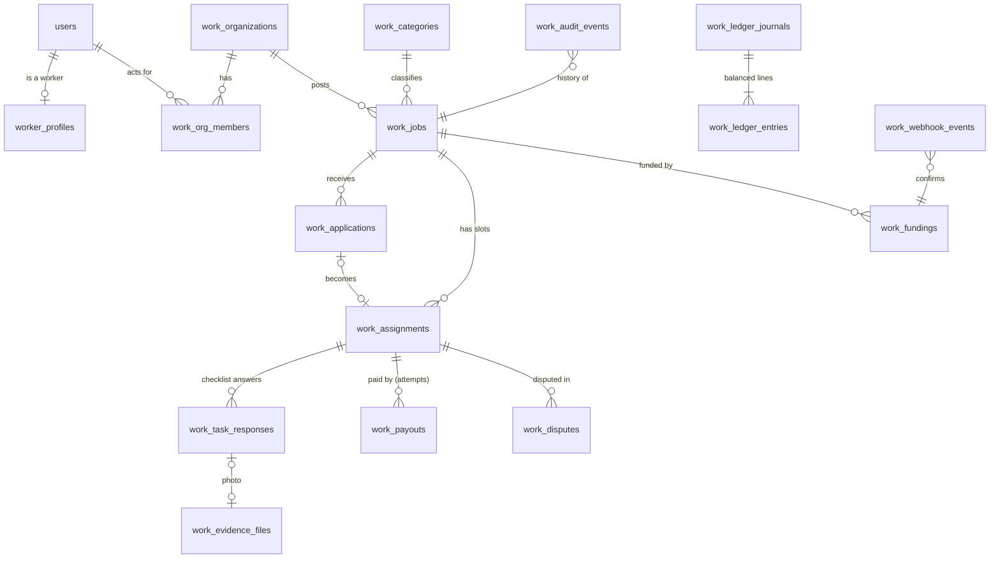
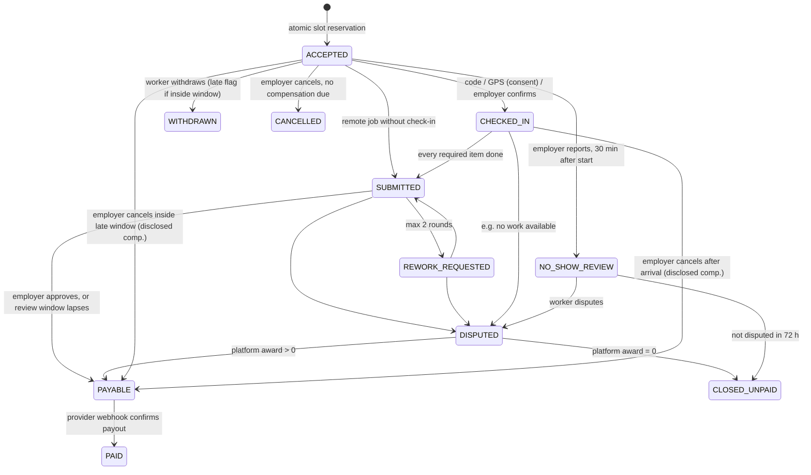

# FastQue Work — architecture

FastQue Work is a student and gig workforce marketplace built **inside the existing FastQue
monorepo**: verified businesses post paid, funded assignments; verified workers (students and
others, 18+) take or apply for them, do the work, submit evidence, get reviewed and get paid.

It reuses FastQue's login (phone OTP / Google / Apple for workers and businesses, TOTP-gated
admin), roles guard, idempotency interceptor, in-app notifications, deadline scheduler and
design system. It adds no second auth, payment or database system.

Status: **Phase 1–3 core flow implemented, sandbox payments only, off by default.**
See [BACKLOG.md](BACKLOG.md) for what is not built, and [RUNNING.md](RUNNING.md) to try it.

## A. Module map

```
packages/shared/src/work-marketplace.ts     enums, zod request schemas, DTOs, state machines,
                                            fee/quote maths, eligibility, anti-scam screening,
                                            rules-based smart draft (pure, unit-tested)

apps/backend/src/work/
  work.module.ts                            wiring + payment-provider factory
  work-config.ts                            feature switches (all off by default)
  work-enabled.guard.ts                     404 on every route until enabled
  work-access.service.ts                    organization tenant isolation (membership per request)
  work-audit.service.ts                     append-only audit trail
  work-ledger.service.ts                    double-entry ledger (balances are always sums)
  payments/work-payment-provider.ts         provider interface, "not configured", SANDBOX adapter
  work-payments.service.ts                  funding, signed webhooks, payable, payouts, release
  work-orgs.service.ts                      business sign-up + KYC review
  work-workers.service.ts                   worker profile, dashboard, earnings, reliability
  work-jobs.service.ts                      posting, validation, publish, discovery, moderation
  work-assignments.service.ts               atomic slot capacity, apply/select, check-in,
                                            checklist + evidence, submit, review, cancellations,
                                            deadline sweep
  work-disputes.service.ts                  neutral dispute pathway
  work-admin.service.ts                     overview, trial balance, audit, employer report
  *.controller.ts                           public / worker / employer / payments / admin routes

apps/web/app/(work)/work/                   marketplace, job detail, worker area, business area
apps/web/app/(dashboard)/dashboard/admin/work/   admin control centre
```

Core job acceptance and payment status never call an AI service. The "smart draft" is a
deterministic parser that only fills fields it can read and lists every missing field.

## B. Entity relationships



Database-level guarantees (migration `20261119100000_work_marketplace`):

| Rule | Mechanism |
|---|---|
| `filledCount` never exceeds `positions` | `CHECK` constraint + row-locked reservation |
| One live assignment per slot, one live slot per worker per job | partial unique indexes |
| At most one in-flight or successful payout per assignment | partial unique index |
| One confirmed funding per job | partial unique index |
| Every ledger journal sums to zero, ≥ 2 lines | deferred constraint trigger |
| Audit events and ledger rows cannot be updated or deleted | `BEFORE UPDATE OR DELETE` triggers |
| Workers 18+, pay within limits, end after start | `CHECK` constraints |

## C. Role-based navigation

| Audience | Where | What |
|---|---|---|
| Visitor | `/work`, `/work/jobs/[id]` | Funded jobs from verified businesses only; no contact details |
| Worker (any signed-in account) | `/work/me` | Profile/onboarding, today, upcoming, awaiting review, completed, applications, earnings, reliability |
| | `/work/me/assignments/[id]` | Instructions, check-in, checklist, evidence, submit, withdraw, dispute, timeline |
| Business member | `/work/business` | Organization + KYC status, jobs, post job (smart draft + guided form), report |
| | `/work/business/[orgId]/jobs/[jobId]` | Preview + quote, publish, fund (sandbox), applicants, assignments, check-in code, cancel, close |
| | `/work/business/[orgId]/assignments/[id]` | Review submission, evidence, duplicate flags, approve / rework / dispute, cancel, no-show |
| Platform admin / co-founder / viewer | `/dashboard/admin/work` | Overview metrics, KYC queue, moderation queue, workers, payouts, disputes, ledger, audit |

Organization roles: `OWNER` (everything), `MANAGER` (post and review jobs), `BILLING` (fund).
Platform: reads for `PLATFORM_ADMIN`, `CO_FOUNDER`, `PLATFORM_VIEWER`; every write
`PLATFORM_ADMIN` only. All checks are server-side.

## D. Job transaction state machines

Implemented in `packages/shared/src/work-marketplace.ts` and applied server-side under row locks.

```mermaid
stateDiagram-v2
  [*] --> DRAFT
  DRAFT --> PENDING_VERIFICATION: publish, screening flagged
  DRAFT --> FUNDING_REQUIRED: publish, validated
  PENDING_VERIFICATION --> FUNDING_REQUIRED: admin approves
  PENDING_VERIFICATION --> REJECTED: admin rejects
  FUNDING_REQUIRED --> OPEN: provider webhook confirms funding
  OPEN --> PARTIALLY_FILLED --> FILLED
  FILLED --> PARTIALLY_FILLED: a worker withdraws
  OPEN --> IN_PROGRESS: first check-in
  PARTIALLY_FILLED --> IN_PROGRESS
  FILLED --> IN_PROGRESS
  IN_PROGRESS --> COMPLETED: employer closes, all work settled
  COMPLETED --> CLOSED: unused funds released
  OPEN --> EXPIRED: start passed, nobody took it
  OPEN --> CANCELLED
  CANCELLED --> CLOSED
  EXPIRED --> CLOSED
```



Applications, fundings, payouts and disputes each have their own status (`WorkApplicationStatus`,
`WorkFundingStatus`, `WorkPayoutStatus`, `WorkDisputeStatus`) — no single ambiguous field.
Every transition writes a `work_audit_events` row on the same transaction.

### Capacity race (the "sixth worker" rule)

`reserveSlot` takes a per-worker advisory lock, then `SELECT … FOR UPDATE` on the job row,
counts live slot-holding assignments, rejects with `WORK_JOB_FULL` when `count ≥ positions`,
and otherwise takes the lowest free slot number. The partial unique index on
`(jobId, slotNumber)` is the database-level backstop. The e2e test fires six concurrent
accepts at a five-slot job and asserts exactly five succeed with slots 1–5.

## E. Payments and reconciliation

No real payment partner is connected. `WORK_PAYMENT_PROVIDER` selects the adapter:

* unset → `UnconfiguredWorkPaymentProvider`: funding fails closed (`WORK_PAYMENTS_NOT_CONFIGURED`),
  no job can open, nothing is ever shown as paid;
* `sandbox` (refused when `NODE_ENV=production`) → `SandboxWorkPaymentProvider`: issues provider
  references, and outcomes arrive only as **HMAC-SHA256-signed webhooks with a timestamp**
  (stale > 5 min rejected, constant-time compare, unique event ids for replay protection).
  The UI labels everything from this provider "Sandbox — no real money moves".

Flow: employer approves the quote for job version *n* → funding order → signed
`funding.succeeded` webhook (amount must match) → ledger `FUNDING_RECEIVED` → job `OPEN`.
Approval → `WORK_APPROVED` (worker payable + platform fee) + payout row in the same transaction →
provider payout with a fixed idempotency key → signed `payout.succeeded` → `PAYOUT_SETTLED` →
`PAID`. A `payout.failed` posts nothing (the obligation stays) and an admin retry creates attempt
*n+1*. Closing, cancelling or expiring a job posts `FUNDS_RELEASED` for unused prefund.

Chart of accounts (positive = debit): `PROVIDER_HELD`, `EMPLOYER_PREFUND:<org>`,
`WORKER_PAYABLE:<user>`, `PLATFORM_FEE_REVENUE`. The admin trial balance checks every journal
sums to zero and that money held at the provider equals the sum of what is owed to employers,
workers and the platform.

Fees are employer-side only (default 10%, `WORK_PLATFORM_FEE_BPS`), frozen into each assignment's
terms. **Workers are never charged.**

Worker protection rules in code: full pay or rework (max 2) — a lower amount only via a platform
dispute decision; submitted work auto-approves when the disclosed review window ends; disputes
freeze the assignment and are decided by a human with a written reason; duplicate-evidence
signals are shown to reviewers and never reject work by themselves.

## F. Threat model (implemented mitigations)

| Threat | Mitigation |
|---|---|
| Fake employers | Business KYC is a human review; only `VERIFIED` organizations publish, fund or appear publicly; suspension hides their jobs |
| Fake / under-age workers | Profile level 1 only from an already-verified phone; DOB check 18+ at profile and acceptance and in a DB `CHECK`; level 2 by a reviewer |
| Stolen accounts | Existing short-lived JWT + rotating refresh + session management; admin TOTP; all writes audited |
| Fraudulent assignments / scams | Rules-based screening (deposits, registration fees, money transfer, crypto/MLM, ID/OTP collection, fake reviews, unrealistic earnings) → human moderation |
| Double acceptance | Advisory lock + row lock + partial unique indexes; idempotency key on accept |
| Duplicate payouts | Partial unique index (one live payout per assignment), fixed provider idempotency keys, webhook event dedupe, ledger idempotency keys |
| Altered evidence / reuse | Magic-byte type detection, size cap, SHA-256 reuse detection, normalized duplicate answers → reviewer flags |
| Webhook forgery / replay | HMAC signature, timestamp window, event-id uniqueness; rejections audited |
| Cross-tenant exposure | Membership resolved per request; every query also filtered by orgId; non-members get 404 |
| Altered job pricing | Published jobs are not editable; publish/fund require the approved version; assignments freeze terms at acceptance |
| Malicious uploads | No SVG/HTML accepted; served with `nosniff`, `private, no-store`, to authorized parties only |
| Prompt injection | No LLM in any marketplace path in this phase |
| Unfair suspension | Suspension needs a written reason, is audited and reversible; reliability is explainable counts, no hidden score |
| Data exfiltration | Public endpoints return no contact or worker data; full UPI IDs never leave the worker's own profile (masked) |

## G. Phased plan

1. **Foundation** — schema, KYC, worker onboarding, permissions. *Done (KYC/verification are
   manual reviews; no external KYC provider).*
2. **Marketplace** — posting, validation, discovery, eligibility, instant accept, apply/select,
   capacity, notifications. *Done.*
3. **Execution and payments** — check-in, checklists, evidence, reviews, disputes, ledger,
   payouts. *Done against the sandbox adapter; a real partner adapter is the next step.*
4. **Advanced operations** — campaigns, college portal, referrals, replacements. *Backlog.*
5. **AI layer** — *Backlog*, behind the same tool-permission and audit rules.
6. **Production hardening** — see the launch checklist in [BACKLOG.md](BACKLOG.md).
